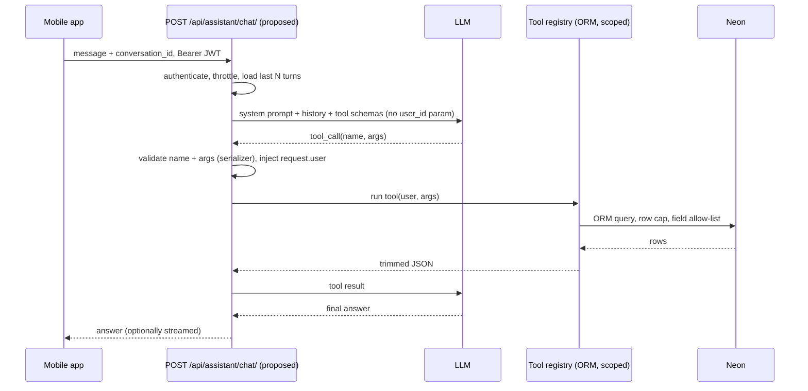

# AI Chatbot Project Audit — FellOo (LGU Peer Collaboration App)

Scope: read-only audit of the repository. No files were modified apart from this report. No database connection was made, no `.env` content was read or reproduced, nothing was installed or migrated.
Legend: **[V]** verified in code, **[I]** inference, **[U]** unknown / not verifiable from the repo.
Line references are to the checked-out `merged` branch.

---

## 1. Executive Summary

- **What it is:** FellOo, a campus app for LGU students: ride sharing, on-demand rides, digital library (projects + notes), printing, resource marketplace, lost and found, peer tutoring, notifications and an admin center. [V]
- **Stack:** Expo 57 / React Native 0.86 (TypeScript, expo-router, Zustand, axios) frontend; Django 5.2 + DRF + SimpleJWT + Channels backend; PostgreSQL on Neon. [V]
- **Monorepo:** `backend/`, `mobile/`, `docs/`. The backend is in this repository. [V]
- **Database access:** only through the Django ORM (psycopg 3). The mobile app never talks to Postgres directly. No raw SQL anywhere outside migrations. [V]
- **Tables:** 36 app models (about 40 app tables including 4 auto-generated M2M tables), plus Django built-ins. Counted from `models.py`, not from the live DB. [V/U]
- **Auth:** email + password, 6-digit email OTP verification, JWT (30 min access, 14 day rotating refresh). Registration only for emails on a `StudentRoster` (LGU roster). [V]
- **AI today:** nothing implemented. No LLM SDK, no tool calling, no embeddings, no pgvector in `requirements.txt`. Design docs plan a pgvector RAG chatbot (`docs/system_design.md` L13, L82-85), but it is not built. [V]
- **Recommendation:** start with approach **A (predefined, user-scoped backend tools + LLM tool calling)** as a new DRF endpoint inside the existing Django app, reusing the ORM querysets the views already scope per user. Add pgvector RAG for policy/FAQ text later. Do **not** start with free-form AI-generated SQL.
- **Biggest risks:** `CORS_ALLOW_ALL_ORIGINS=True` in base; `ALLOWED_HOSTS=["*"]` and `DEBUG=True` in the default settings module; no throttling; marketplace/library data readable by every user, so a chatbot must not widen what a user can already see; PII-bearing fields (phone, GPS, plate numbers, uploads) must be excluded from any LLM context.

---

## 2. Verified Technology Stack

| Area | Finding | Evidence |
|---|---|---|
| Mobile framework | Expo SDK 57 (managed), React Native 0.86.3, React 19.2.3 | `mobile/package.json` |
| Language | TypeScript ~6.0.3 | `mobile/package.json` |
| Navigation | expo-router ~57 (file-based, routes in `mobile/app/`, logic in `mobile/src/features/*`) | `mobile/app/`, the mobile rules file |
| State | Zustand 5 (`session.ts`, `useModuleUsageStore.ts`) + custom `DataStore` / `PersistentCache` | `mobile/src/core/auth/session.ts`, `mobile/src/core/data/`, `mobile/src/core/store/` |
| UI | Hand-rolled components (`mobile/src/core/ui/`), `@expo/vector-icons`, expo-linear-gradient, expo-blur | `mobile/package.json` |
| HTTP | axios with Bearer interceptor and single-flight refresh | `mobile/src/core/network/apiClient.ts` L22-60 |
| Secure storage | `expo-secure-store` on native, `localStorage` on web | `mobile/src/core/auth/session.ts` L6-14 |
| Platforms | iOS, Android, web (react-native-web); `app.json` has ios/android/web blocks | `mobile/app.json` |
| Package manager | npm (`package-lock.json`) | `mobile/` |
| Backend | Django 5.2.17, DRF 3.17.2, simplejwt 5.5.1, django-filter, drf-spectacular, django-cors-headers, Channels 4.3.2 + Daphne, psycopg[binary] 3.3.4, python-dotenv, Pillow | `backend/requirements.txt` |
| DB | PostgreSQL (Neon), `sslmode` from env; `CONN_MAX_AGE=60`, `CONN_HEALTH_CHECKS=True` | `backend/config/settings/base.py` L78-97 |
| Realtime | Channels WebSockets, `InMemoryChannelLayer` (single process only) | `base.py` L76, `config/routing.py` |
| API docs | drf-spectacular: `/api/schema/`, `/api/docs/` (Swagger) | `config/urls.py` |
| Dev workflow | `run.bat` starts `manage.py runserver 0.0.0.0:8000` and `npm run web` | `run.bat` |

---

## 3. Project Directory Map

```
/
├─ the root rules file, run.bat, .gitignore
├─ docs/                 SRS.md, system_design.md, documentation.txt, history.txt, api-contracts/, design/
├─ backend/
│  ├─ manage.py, requirements.txt, .env.example   (.env present locally, gitignored, not read)
│  ├─ config/            settings/{base,dev,prod}.py, urls.py, asgi.py, routing.py
│  ├─ accounts/          User, EmailVerification, StudentRoster; auth + admin API
│  ├─ common/            Department, notifications.notify(), storage, geo
│  └─ apps/              rides, ondemand, library, printing, resource_sharing,
│                        lost_and_found, peer_tutoring, notifications
└─ mobile/
   ├─ app/               expo-router routes: (auth)/ and (app)/<module>/
   └─ src/
      ├─ core/           auth/session, network/apiClient, ui/, data/, store/
      └─ features/       <feature>/{data,presentation} per module
```

---

## 4. Features and User Flows

| Module | What users do | Backend | Mobile |
|---|---|---|---|
| Auth / profile | Register (roster email), verify OTP, login, forgot/reset password, view profile | `accounts/views.py` | `src/features/auth/` |
| Ride sharing | Offer a ride, search, request to join, accept/decline, start/complete/cancel. Same-gender filter | `apps/rides/` | `app/(app)/rides/` |
| On-demand rides | Rider requests a ride, driver applies/approves, accept → arrived → start → complete, fare quote | `apps/ondemand/` | `app/(app)/ondemand/` |
| Digital library | Upload/browse projects (moderated by status) and notes, upvote, bookmark | `apps/library/` | `app/(app)/library/` |
| Printing | Request prints, printers accept/reject/complete, ratings | `apps/printing/` | `app/(app)/printing/` |
| Marketplace | Listings, interest requests, "wanted" posts + offers, chat | `apps/resource_sharing/` | `app/(app)/resources/` |
| Lost and found | Post items, claims, claim chat | `apps/lost_and_found/` | `app/(app)/lost-and-found/` |
| Peer tutoring | Tutor profiles, sessions, reviews, collaboration requests, session chat | `apps/peer_tutoring/` | `app/(app)/tutoring/` |
| Notifications | Per-user and broadcast notifications, read/dismiss state | `apps/notifications/` | bell / `rides/notifications.tsx` |
| Admin center | Overview, moderation, users, catalog, broadcasts (password re-check) | `accounts/admin_views.py` | `app/(app)/admin.tsx` |

Roles: `student`, `admin` (`accounts/models.py` L31-33). Admin is auto-assigned from the `ADMIN_EMAILS` env var in `User.save()` (L46-49). Drivers/printers/tutors are profile records, not roles. Existing chatbot/AI: none. Chat features are peer-to-peer messaging only. [V]

---

## 5. Backend and API Inventory

Base URL: `EXPO_PUBLIC_API_URL` / `EXPO_PUBLIC_WEB_API_URL`, else Metro host IP:8000, else `http://localhost:8000/api` (`apiClient.ts` L7-18). Auth header: `Authorization: Bearer <access>`. REST + paginated lists (`PageNumberPagination`, page size 20). Default auth class is JWT only (`base.py` L125-131). Most views set `IsAuthenticated` explicitly; I did not confirm that every one of the ~120 routes does. [V/U]

| Prefix | Routes (from `urls.py` files) | Notes |
|---|---|---|
| `/api/auth/` | `register/`, `verify-email/`, `forgot-password/`, `reset-password/`, `login/`, `refresh/`, `me/` | first five are `AllowAny` |
| `/api/auth/debug/add-roster/` | POST | only mounted when `DEBUG`, `AllowAny` (`config/urls.py` L28-35) |
| `/api/admin/` | `verify-password/`, `overview/`, `marketplace/`, `lost-and-found/`, `tutoring/`, `users/`, `catalog/` | `IsPlatformAdmin` |
| `/api/rides/` | `locations/`, list/create, `mine/`, `<id>/`, `join/`, `cancel/`, `start/`, `complete/`, `requests/` | |
| `/api/ondemand/` | `places/`, `fare/`, `profile/`, `profile/apply/`, `profile/stop-driving/`, `driver/status/`, `driver/requests/`, `rides/...` (create, current, detail, accept, arrived, start, complete, retry, cancel) | |
| `/api/library/` | projects (list, mine, detail, upvote, bookmark), `notes/...` same shape | |
| `/api/printing/` | list/create, `mine/`, `printers/`, `printers/me/`, accept/reject/release/complete/cancel/rate | |
| `/api/resources/` | list/create, `summary/`, `mine/`, `wanted/...`, interest-request and chat routes | |
| `/api/lost-and-found/` | list/create, `mine/`, `summary/`, `<id>/status/`, claims, claim chat messages | |
| `/api/tutoring/` | catalog courses/skills, tutors, sessions, messages, reviews, collaborations, `summary/` | |
| `/api/notifications/` | list, mark-read, dismiss-popup, mark-all-read, admin CRUD | |
| `/api/departments/`, `/api/courses/` | reference lists | |
| WebSockets | `ws/resources/requests/<id>/chat/`, `ws/resources/offers/<id>/chat/`, `ws/lost-and-found/claims/<id>/chat/`, `ws/tutoring/sessions/<id>/chat/` | JWT passed as `?token=` query string (`websocket_auth.py`) |

Request/response shapes are defined in each app's `serializers.py` and in `docs/api-contracts/`; Swagger at `/api/docs/` is the authoritative source per the root rules file. I did not enumerate every schema here. [U]

Error handling: axios interceptor retries once after a 401 using the refresh token and clears the session if refresh fails (`apiClient.ts` L26-60). No global timeout or retry policy found. Streaming/SSE: none. [V]

---

## 6. Database Schema and Relationships

Source: model definitions and migrations only. Live Neon schema is **[U]**; the root rules file says app labels are frozen to match existing Neon tables, so real table names follow Django's default `<app_label>_<model>` pattern except where `db_table` is set. One `db_table` override exists in `common/migrations/0003_academiccourse.py` L46 (`peer_tutoring_academiccourse`). [V]

### 6.1 Model inventory (36)

| App | Model | Key columns / constraints |
|---|---|---|
| accounts | User | email (unique), role, is_email_verified, is_active, is_staff, created_at |
| accounts | EmailVerification | user FK, code (6 digit), expires_at |
| accounts | StudentRoster | email (unique), roll_no, full_name, dept FK, enrollment_year, gender, phone_number |
| common | Department | name (unique), short_name (unique) |
| library | LibraryProject | author FK, title, department FK, abstract, github_link, level, status, upvoted_by M2M, bookmarked_by M2M |
| library | LibraryProjectFile | project FK, file |
| library | Note | author FK, title, course FK→AcademicCourse, semester, description, upvoted_by/bookmarked_by M2M |
| library | NoteFile | note FK, file |
| rides | Location | name (unique), lat, lng |
| rides | Ride | offerer FK, departure/destination text + lat/lng, departure_date/time, seats_total/available, same_gender_only, status, started_at, completed_at |
| rides | RideJoinRequest | ride FK, requester FK, status; unique (ride, requester) |
| ondemand | RideProfile | user 1:1, role, vehicle fields incl. plate_number, is_approved, is_online, last_lat/lng/seen |
| ondemand | FareSetting | rate_per_km |
| ondemand | Place | name (unique), lat, lng |
| ondemand | OnDemandRide | rider FK, driver FK, pickup/drop label+lat/lng, distance_km, fare, route JSON, status, cancelled_by, accepted_at |
| printing | PrinterProfile | user 1:1, location_note, supports_color, supports_double_sided |
| printing | PrintRequest | requester FK, printer FK, target_printer FK, document file, page_range, copies, is_color, is_double_sided, status, collection_note, timestamps |
| printing | PrintRating | request 1:1, printer FK, rater FK, score 1-5, comment |
| resource_sharing | ResourceListing | owner FK, title, category, course (text), condition, exchange_type, price, image, description, status |
| resource_sharing | ResourceInterestRequest | resource FK, requester FK, message, status; unique per student |
| resource_sharing | PublicResourceRequest | requester FK, title, category, course, desired_exchange_type, description, status |
| resource_sharing | PublicResourceOffer | public_request FK, offerer FK, message, status; unique per student |
| resource_sharing | ResourceChatMessage, PublicResourceOfferChatMessage | parent FK, sender FK, body, image |
| lost_and_found | LostAndFoundItem | poster FK, post_type, title, category, location, date_lost_or_found, description, image, status |
| lost_and_found | ItemClaim | item FK, claimant FK, message, status |
| lost_and_found | ItemClaimChatMessage | claim FK, sender FK, body, image |
| peer_tutoring | TutorProfile | user 1:1, profile_type, headline, bio, subjects JSON, skills JSON, availability, is_free, hourly_fee, average_rating, total_reviews, is_active |
| peer_tutoring | TutoringSession | tutor FK, learner FK, subject_or_skill, session_type, meeting_mode, location_or_link, scheduled_at, duration_minutes, notes, status |
| peer_tutoring | SessionReview | session 1:1, reviewer FK, tutor FK, rating, comment |
| peer_tutoring | CollaborationRequest | creator FK, title, category, required_skills JSON, description, contact_info, status |
| peer_tutoring | TutoringChatMessage | session FK, sender FK, body, image |
| peer_tutoring | AcademicCourse | code (unique), title, department FK, description, is_active |
| peer_tutoring | SkillTopic | name (unique), category, is_active |
| notifications | CampusNotification | uuid PK, title, message, category, priority, action_url, image, target_user FK (null = broadcast), created_by FK, is_active |
| notifications | UserNotificationState | uuid PK, user FK, notification FK, is_read, is_popup_dismissed; unique (user, notification) |

Plus Django built-ins (`auth_*`, `django_migrations`, `django_admin_log`, `django_session`, `django_content_type`) and 4 auto M2M tables (library upvotes/bookmarks for projects and notes).

### 6.2 ER diagram (verified relationships, abridged)

```mermaid
erDiagram
    USER ||--o{ RIDE : offers
    USER ||--o{ RIDE_JOIN_REQUEST : requests
    RIDE ||--o{ RIDE_JOIN_REQUEST : has
    USER ||--o{ ONDEMAND_RIDE : rides
    USER ||--o| RIDE_PROFILE : has
    USER ||--o{ LIBRARY_PROJECT : authors
    USER ||--o{ NOTE : authors
    DEPARTMENT ||--o{ LIBRARY_PROJECT : groups
    ACADEMIC_COURSE ||--o{ NOTE : tags
    DEPARTMENT ||--o{ ACADEMIC_COURSE : owns
    DEPARTMENT ||--o{ STUDENT_ROSTER : contains
    USER ||--o{ PRINT_REQUEST : requests
    PRINT_REQUEST ||--o| PRINT_RATING : rated
    USER ||--o{ RESOURCE_LISTING : owns
    RESOURCE_LISTING ||--o{ RESOURCE_INTEREST_REQUEST : receives
    USER ||--o{ PUBLIC_RESOURCE_REQUEST : posts
    PUBLIC_RESOURCE_REQUEST ||--o{ PUBLIC_RESOURCE_OFFER : receives
    USER ||--o{ LOST_FOUND_ITEM : posts
    LOST_FOUND_ITEM ||--o{ ITEM_CLAIM : receives
    USER ||--o| TUTOR_PROFILE : has
    USER ||--o{ TUTORING_SESSION : tutors_or_learns
    TUTORING_SESSION ||--o| SESSION_REVIEW : reviewed
    USER ||--o{ COLLABORATION_REQUEST : creates
    CAMPUS_NOTIFICATION ||--o{ USER_NOTIFICATION_STATE : tracked
    USER ||--o{ USER_NOTIFICATION_STATE : has
```



Important quirk: **`User` has no name/department/phone columns.** Those come from `StudentRoster` matched by email at runtime (`accounts/models.py` L51-101). Any SQL-level chatbot must join `accounts_user` to `accounts_studentroster` on `lower(email)`. [V]

Several `status` fields are free enums on each model (see each `Status` TextChoices); there is no shared status table. `TutoringSession.tutor`/`learner` and `SessionReview.tutor` are FKs to `User` (verified, `peer_tutoring/models.py` L72-81, L128-133). [V]

### 6.3 Needs a safe read-only inspection to verify
- Real table and column names, indexes, nullability, row counts (`information_schema`).
- Whether migrations are fully applied on Neon (`migrate --check` is clean locally per the earlier session).
- Which Postgres roles exist and their grants; whether a read-only role can be created on Neon.
- Whether any row-level security exists (none appears in code or migrations). [U]
- Whether `pgvector` is installed on the Neon project.

---

## 7. Authentication and Security Assessment

**Verified mechanism**
- Register: email must be on `StudentRoster` and end in `lgu.edu.pk` (`accounts/serializers.py` L18-24; `LGU_EMAIL_DOMAIN` in `base.py`). Account is inactive until the OTP is verified (`models.py` L40).
- Login: SimpleJWT `TokenObtainPairView`. Access 30 min, refresh 14 days, rotation on (`base.py` L137-141).
- Identity reaches the backend via the `Authorization` header only; views derive the user from `request.user`, e.g. `Ride.objects.filter(offerer=self.request.user)` (`rides/views.py` L113), `LibraryProject.objects.filter(author=request.user)` (`library/views.py` L76), printing queryset by role (`printing/views.py` L54-61). Client-supplied user IDs were not seen in the views I read. [V for the files sampled]
- Ownership permissions exist as DRF classes (`resource_sharing/permissions.py`, `lost_and_found/permissions.py`, `peer_tutoring/permissions.py`).
- Admin: `IsPlatformAdmin` (role admin or `is_staff`) on `/api/admin/*`; extra password re-check endpoint.
- WebSocket chats check participation in `connect()` (e.g. `lost_and_found/consumers.py` L6-17).

**Gaps and concerns**
1. `CORS_ALLOW_ALL_ORIGINS = True` in `base.py` L151; only `prod.py` turns it off.
2. Default settings module (`manage.py`, `asgi.py`) is `config.settings.dev` with `DEBUG=True`, `ALLOWED_HOSTS=["*"]`. A deploy that forgets `DJANGO_SETTINGS_MODULE` ships debug mode.
3. `SECRET_KEY` falls back to an insecure default when the env var is missing (`base.py` L16).
4. OTP is emitted by the console email backend (`base.py` L122); no real mail provider. OTP is a 6-digit `random.randint` (not `secrets`) (`models.py` ~L130-140).
5. No throttling or rate limiting anywhere (`grep` for throttle/ratelimit found nothing). Login, OTP and any future LLM endpoint are open to abuse and cost attacks.
6. JWT in WebSocket query string is logged by proxies; tokens on web live in `localStorage` (XSS-readable).
7. `InMemoryChannelLayer` breaks with multiple workers.
8. Test coverage is minimal: `common/tests.py` has 2 tests; `accounts/tests.py` and `resource_sharing/tests.py` contain none.
9. No audit logging found. [U if added elsewhere]
10. Broad read access by design: any authenticated student can list approved library items, open marketplace listings, tutors, lost-and-found posts. That is product behaviour, but a chatbot must not give access beyond these same scopes.
11. A debug roster-creation endpoint exists behind `DEBUG` (`AllowAny`). Safe only if DEBUG is truly off in prod.

**Fields that must never go to an LLM**
`password`, `EmailVerification.code`, JWTs, `StudentRoster.phone_number`, `roll_no`, exact GPS (`*_lat`, `*_lng`, `last_lat/lng`), `RideProfile.plate_number`, uploaded files (`document`, `file`, images), chat message bodies, `contact_info`, other users' emails, `ADMIN_EMAILS`, anything from the admin endpoints unless the caller is admin.

---

## 8. AI Integration Readiness

| Capability | Status |
|---|---|
| LLM SDK (OpenAI, Anthropic, Gemini) | Not present [V] |
| Tool calling / agents / LangChain | Not present [V] |
| Embeddings / pgvector | Not installed; only mentioned in `docs/system_design.md` and `docs/documentation.txt` [V] |
| Chat message model for a bot | None (existing chat models are peer-to-peer) |
| Background jobs | None (no Celery/RQ); Channels exists for sockets |
| Streaming (SSE/WebSocket) | WebSockets exist for peer chat; reusable pattern |
| Endpoint to host assistant | None; would be new, e.g. `POST /api/assistant/chat/` |
| Per-user scoped querysets | Present and reusable in each app's views |
| Mobile chat UI | Peer-chat screens exist (`tutoring/chat/[sessionId].tsx` etc.) as a UI pattern to copy |

Needs building: new `assistant` Django app, LLM client + key in env, tool registry, conversation tables, throttling, mobile chat screen, tests.

---

## 9. Recommended AI Chatbot Architecture

### 9.1 Options compared

| | A. Predefined tools | B. AI-generated read-only SQL | C. Hybrid |
|---|---|---|---|
| Fit with this codebase | Excellent: wrap existing ORM querysets | Poor: `User` lacks name/dept (roster join), status enums are app-level, FK to User everywhere | Good later |
| Security | Strong: model never writes SQL, user scope is code | Weak: needs SQL parser, role with row filters, no RLS present | Medium |
| Cross-user leakage | Controlled per tool | High risk; no RLS in DB | Controlled for tools, risky for SQL part |
| Flexibility | Limited to the tools you write | High | High |
| Cost | Low (small context, one or two tool rounds) | Higher (schema in prompt, retries) | Medium |
| Maintainability | New tool per question type | Schema drift breaks prompts | Both burdens |

**Recommendation: A first.** The data is small, per-user scoping is already expressed in ORM code, and there is no RLS to fall back on. Add a RAG tool over policy/FAQ text (pgvector, as the design docs intend) as a second step. Defer B; if analytics need it, run it only against an aggregated, PII-free read-only view for admins.

### 9.2 Proposed flow (all proposed, none exists)



Design points:
- **Auth:** reuse the existing JWT; `permission_classes=[IsAuthenticated]`. Tool functions take `user` from `request.user`; the model can never supply a user ID.
- **Tools (examples):** `my_rides`, `my_ride_requests`, `search_open_rides`, `my_print_jobs`, `my_tutoring_sessions`, `search_library`, `search_resources`, `my_notifications`, `lost_found_search`, `tutors_for_course`. Each returns a field allow-list (no phone, GPS, plate, files).
- **Validation:** JSON-schema args via DRF serializers; enum filters; hard row cap (e.g. 10); date range limits; read-only DB transaction or `SELECT`-only role.
- **History:** a `ChatConversation` / `ChatMessage` table owned by the user; send only the last N turns; summarise older ones. Follow-ups resolve through history.
- **Prompt injection:** treat every DB text field (titles, descriptions, notes, chat) as untrusted data inside a delimited block; the system prompt states that tool output is data, not instructions; tools are read-only so injection cannot cause writes; no tool takes a free `user_id` or raw SQL.
- **Cost/abuse controls:** DRF throttle (per user per minute/day), max input length, max tool rounds (3), `max_tokens`, log token usage per user.
- **Errors:** tool failures return a short error object to the model; user sees a generic fallback; log with request ID.
- **Schema metadata:** not needed for A; tool descriptions are enough. Needed only for B/C.
- **Streaming:** optional; start non-streaming, add SSE or a Channels consumer later.

---

## 10. Candidate Chatbot Questions (15)

| # | Question | Source | Operation | Answerable from schema now? | Permission |
|---|---|---|---|---|---|
| 1 | "What rides am I offering this week?" | rides.Ride | filter by offerer + date | Yes | own rows |
| 2 | "Did the driver accept my ride request?" | RideJoinRequest + Ride | join, filter | Yes | requester = me |
| 3 | "Find rides to Johar Town tomorrow morning" | Ride, Location | filter text/date/time | Yes (free-text locations) | auth; gender rule as in `RideListCreateView` |
| 4 | "What's the status of my print job?" | PrintRequest | filter | Yes | requester/printer = me |
| 5 | "How much did I spend on on-demand rides this month?" | OnDemandRide.fare | filter + sum | Yes | rider = me |
| 6 | "Show approved library projects about machine learning" | LibraryProject | text search + status filter | Yes | auth; approved only |
| 7 | "Find CS-201 notes with the most upvotes" | Note, AcademicCourse, M2M | join + count + order | Yes | auth |
| 8 | "Which of my library uploads are still pending approval?" | LibraryProject | filter | Yes | author = me |
| 9 | "Any textbooks for sale under 1500?" | ResourceListing | filter category/price/status | Yes | auth; active listings |
| 10 | "Has anyone claimed the wallet I found?" | LostAndFoundItem, ItemClaim | join | Yes | poster = me; no claimant PII beyond name |
| 11 | "Who can tutor me in Financial Accounting, free of charge?" | TutorProfile (subjects JSON, is_free) | JSON contains + filter | Partly: subjects/skills are JSON, matching needs care | auth; active profiles |
| 12 | "When is my next tutoring session?" | TutoringSession | filter + order | Yes | learner or tutor = me |
| 13 | "What is my average rating as a tutor?" | TutorProfile / SessionReview | aggregate | Yes | own |
| 14 | "Do I have unread notifications?" | CampusNotification, UserNotificationState | filter, count | Yes | own + broadcast |
| 15 | "How many open tutoring/marketplace/lost-found posts are there per department?" (admin) | several + Department | group by, joins | Partly: dept links only via roster for users | admin only |

Questions about campus policy, registration or course advice need the RAG corpus from the design docs and are **not** answerable from the DB today.

---

## 11. Unknowns and Missing Information

- Live Neon schema, indexes, row counts, roles, grants, RLS, pgvector availability.
- Exact request/response schemas for all endpoints (only routes were enumerated; see Swagger).
- Whether every view enforces `IsAuthenticated` (default permission is not set globally; sampled views do).
- Production deployment: settings module, hosting, HTTPS, SMTP, file storage (currently local `MEDIA_ROOT`).
- Whether FCM push (mentioned in docs) exists. No code found.
- Meaning/values of each model's `Status` enums (in the model files, not tabulated here).
- LLM provider, budget and data-residency constraints (user decision).
- Whether chat bodies may be used as AI context (privacy decision, recommended no).

---

## 12. Prioritized Implementation Roadmap

**Phase 0: Resolve missing information**
- Run a read-only `information_schema` dump on Neon (or `inspectdb` against a copy); confirm table names and counts.
- Decide the LLM provider, monthly budget and what data classes are allowed in prompts.
- Confirm prod settings, CORS and `ALLOWED_HOSTS`; fix item 1-3 in section 7 before exposing a paid endpoint.

**Phase 1: Minimal read-only chatbot**
- New `assistant` app, `POST /api/assistant/chat/`, JWT required, DRF throttle.
- 5-8 tools from section 9.2 with field allow-lists and row caps; non-streaming.
- Mobile chat screen modelled on the existing chat UI; no history persistence beyond the session.
- Tests: tool scoping (user A never sees user B), arg validation, throttle.

**Phase 2: Conversation context and follow-ups**
- `ChatConversation` / `ChatMessage` tables, last-N-turn window, summarisation, title.
- Streaming (SSE or Channels), retry and cancellation in the mobile client.

**Phase 3: Broader analytics and retrieval**
- pgvector + RAG over policy/FAQ documents with source citations.
- Admin-only aggregate tools; optionally controlled SQL against PII-free read-only views.

**Phase 4: Production hardening**
- Prompt-injection and leakage test suite, usage dashboard, per-user budgets, audit log, response caching, model fallback, `channels_redis`, real SMTP, move uploads to object storage.

---

## 13. Evidence Appendix

| Claim | File : line |
|---|---|
| Apps list and middleware | `backend/config/settings/base.py` L20-60 |
| DB config, pooling | `backend/config/settings/base.py` L78-97 |
| DRF defaults (JWT, pagination) | `backend/config/settings/base.py` L125-135 |
| JWT lifetimes | `backend/config/settings/base.py` L137-141 |
| CORS allow all | `backend/config/settings/base.py` L151 |
| Insecure SECRET_KEY fallback | `backend/config/settings/base.py` L16 |
| Console email backend | `backend/config/settings/base.py` L122 |
| In-memory channel layer | `backend/config/settings/base.py` L76 |
| Dev settings: DEBUG/ALLOWED_HOSTS | `backend/config/settings/dev.py` L3-4 |
| Prod overrides | `backend/config/settings/prod.py` |
| Default settings module | `backend/manage.py` L9, `backend/config/asgi.py` L5 |
| URL tree | `backend/config/urls.py` L8-27 |
| Debug roster endpoint | `backend/config/urls.py` L28-35, `backend/accounts/views.py` L187-233 |
| User model, roles, admin promotion | `backend/accounts/models.py` L30-49 |
| User details derived from roster | `backend/accounts/models.py` L51-101 |
| Roster check at registration | `backend/accounts/serializers.py` L18-24 |
| `IsPlatformAdmin` | `backend/accounts/admin_views.py` L19-31 |
| Ownership scoping examples | `backend/apps/rides/views.py` L113; `backend/apps/library/views.py` L76; `backend/apps/printing/views.py` L54-61 |
| Ownership permission classes | `backend/apps/resource_sharing/permissions.py` |
| WebSocket JWT query auth | `backend/apps/resource_sharing/websocket_auth.py` |
| WebSocket routes | `backend/config/routing.py` |
| Chat access check | `backend/apps/lost_and_found/consumers.py` L6-17 |
| Model definitions | `backend/accounts/models.py`; `backend/common/models.py`; `backend/apps/*/models.py` |
| `db_table` override | `backend/common/migrations/0003_academiccourse.py` L46 |
| API client, refresh logic | `mobile/src/core/network/apiClient.ts` L7-60 |
| Session store and token storage | `mobile/src/core/auth/session.ts` L6-60 |
| Mobile deps and versions | `mobile/package.json` |
| Planned pgvector RAG (not built) | `docs/system_design.md` L13, L82-85; `docs/documentation.txt` L392-399 |
| Project conventions (app labels frozen, Neon is source of truth) | the root rules file |
