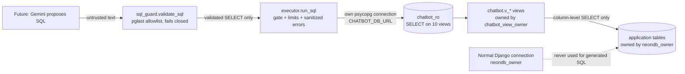

# FellOo AI Chatbot - Phase 2 Report: Secure Database Access Layer

**Status (2026-10-20): Phase 2 validation is NOT complete. The offline suite is 72 tests (52 run, 20 database-backed skipped, 0 failures). Provisioning, verification, cleanup, re-provisioning and the section 20 test fix were validated on disposable LOCAL PostgreSQL only (sections 14, 17, 19, 21: 72 tests pass on both a NULL and an explicit database ACL baseline); nothing has been run on Neon. The generated-SQL path is DISABLED (`CHATBOT_SQL_ENABLED` unset) and must stay disabled until `chatbot_ro` is provisioned on a Neon branch copy and its isolation is verified there.**

Evidence tags used below:

| Tag | Meaning |
|---|---|
| **[LOCAL-RUN]** | Executed on a throwaway local PostgreSQL 18.4 cluster (never Neon). Applies only to the run named where the tag is used: the first run (provisioning v1, 18 integration tests) in section 0's historical snapshot; later v2 runs in sections 14, 17 and 19. |
| **[OFFLINE]** | Parsed or statically cross-checked with `pglast` / unit tests. No database involved. Includes the small models of ACL behaviour in the tests: they check the design logic and the SQL text, not PostgreSQL behaviour. |
| **[LIVE-META]** | From the live Neon metadata you supplied: a read-only capture produced with `docs/ai_chatbot_neon_metadata_audit.sql`. The full capture is intentionally **not** in the repository (kept outside version control); the facts used are summarised in this report. Read-only catalog facts, not a validation of Neon behaviour. |
| **[NEON-DOCS]** | From Neon's public documentation (read, not executed). |
| **[UNVERIFIED]** | Not verified on Neon. Must be proven on a branch copy. |

---

## 0. What is verified and what is not (read this first)

### Current status (2026-10-20)

**Current design: v2** of the provisioning, verification and cleanup SQL, as amended by sections 15 (no bulk table/sequence REVOKEs) and 18 (database ACL written only when needed and restored by cleanup; the schema `public` REVOKE is also gone). v1 is historical and no longer used. The SQL file headers used to say "NOT EXECUTED - FOR REVIEW ONLY"; since section 22 they say "VALIDATED ON DISPOSABLE LOCAL POSTGRESQL ONLY - NOT VALIDATED ON NEON" (reported results, not independently reproduced when the headers were rewritten).

| Layer | Current state |
|---|---|
| **Offline** (no database): unit, file-text and model tests | **72 tests: 52 run, 20 database-backed skipped, 0 failures.** The 20 skip because no `CHATBOT_TEST_*` variable is set; every class is `SimpleTestCase`, so Django opens no connection. The ACL round-trip and probe-login tests contain small models of ACL behaviour: they prove the design logic and the SQL text, **not** PostgreSQL behaviour. |
| **Local PostgreSQL, validated** (disposable 18.x, literal loopback, throwaway data directories; sections 14, 17, 19) | Provisioning, verification (18 queries), the guarded-cleanup negative test, armed cleanup and re-provisioning all behaved as expected; no table, sequence, schema, column or default ACL outside the chatbot objects changed. Database ACL round trip: **NULL baseline restored to NULL; explicit baseline (PUBLIC CONNECT revoked, unrelated role grant) restored exactly.** Database-backed tests: 68 passed in section 17 and 70 passed on the NULL baseline in section 19, against the suite as it was then. The current provisioning script has 48 statements (command tags in the psql output). |
| **Local PostgreSQL, earlier failure, fix since validated (section 21)** | On the explicit baseline the over-privileged-role test errored (section 19: 69 of 70 passed). The section 20 fix (temporary `CONNECT` granted only when needed, revoked before `DROP ROLE`) was then run on both baselines on local PostgreSQL: **72 run, OK, 0 skipped, 0 failures, 0 errors in each case, and again after re-provisioning.** Local only. |
| **Neon** | **Not validated.** Nothing was executed against Neon. Whether the chatbot role/view/grant configuration works there is unproven: the self-grant with `SET`, the grantor Neon records, SQL Editor and pooler behaviour, PostgreSQL 18.6, the database ACL, live status values. |
| **Switches / repository** | `CHATBOT_SQL_ENABLED` is unset and the SQL path is disabled. Nothing is committed. The five local disposable clusters (ports 54329 to 54333) were stopped and deleted at the end of section 21; port 5432 was never touched. |

**Reproduction limitation:** the preflight script, its self-tests and the canary/snapshot SQL used for every local run live outside the repository (session scratchpad) and are not committed; section 22 lists them with SHA-256 hashes and says why they were not copied.

The two lists below are **historical snapshots** of earlier stages, kept for context. Their counts and wording describe those stages, not the current state.

**Historical snapshot 1, first local run, provisioning v1 [LOCAL-RUN] (PostgreSQL 18.4, schema built from this repo's migrations):**
- The role/schema/view/grant design works end to end; `chatbot_ro` can read only the ten views and was denied on every base table, DDL, write, `SET ROLE`, `pg_authid`, and role creation.
- `verify_isolation()` returned `[]` for the provisioned role and a non-empty list for an over-privileged role and for the owner.
- Four deliberate privilege breakages (extra `SELECT`, `BYPASSRLS`, broader role membership, removed read-only default) were each caught.
- The cleanup section removed everything (0 roles, 0 schemas, 0 default ACLs, 0 column grants) and provisioning could be re-applied.
- The 3-second timeout cancelled `pg_sleep(6)`; row/byte caps, minimum group size, sanitized errors and the aggregate budget worked.
- 18 integration tests passed against v1.

**Historical snapshot 2, offline checks of v2 before its first local run [OFFLINE] (no database; counts are as of then: 51 statements, 46 tests, 19 skipped):**
- All three SQL files parse (provisioning 51 statements, verification 18, cleanup 26) and all 8 embedded PL/pgSQL bodies parse.
- Every column in every `GRANT` exists in the live Neon column list; granted columns equal the columns the views read (0 problems).
- The ten view column lists equal `catalog.py` (which no longer contains `message`); every view is `security_barrier`.
- The cleanup revokes exactly the 12 column grants that provisioning makes; the verification file is `SELECT`-only.
- There is no password, no connection string, and no `GRANT`/`REVOKE` touching `PUBLIC` in provisioning (the single `PUBLIC` mention is a default-privilege rule for functions the view owner might create later).
- The cleanup's guard now runs **inside** the transaction: `BEGIN` is the first statement, the guard is the second, and the identity block (role and schema markers, schema owner, exactly the ten expected views, no functions) is the third, all before the first destructive statement. A parse-level test asserts that order and that there is exactly one `BEGIN` and one `COMMIT`. In PostgreSQL an error inside an open transaction makes every later statement fail until `COMMIT`, which then rolls back, so a failed guard stops the script even without `ON_ERROR_STOP`. This is reasoning about documented PostgreSQL behaviour plus the statement order; it has not been demonstrated on a running server.
- Provisioning writes identity markers (`COMMENT ON ROLE` x2, `COMMENT ON SCHEMA`), asserts the temporary `SET`/`INHERIT` membership before revoking it and again afterwards, and asserts the markers exist.
- The byte cap is now computed by a pure function (`_fit_rows`) that is tested at the exact serialized-size boundary, byte by byte, for 40 row counts.
- 46 unit/file tests pass; 19 integration tests are skipped because they need a provisioned database.
- **Mutation check (in memory, nothing on disk changed):** the new tests were fed the old cleanup file, the old provisioning file, the old byte arithmetic, a lax DSN validator, a lax server check, and a source with broad error assertions and a hard-coded owner. All 7 mutations made the corresponding tests fail.
- A fail-closed preflight script for the local disposable instance exists **outside the repository** (section 12) with 15 offline self-tests that pass; it has never been pointed at a database.

**Confirmed from the live metadata you supplied [LIVE-META]:** PostgreSQL 18.6; `neondb_owner` has `CREATEROLE` and `BYPASSRLS` and belongs to `neon_superuser`; no RLS; no table ACLs beyond owners; no views or user functions; `public` schema has `USAGE` for `PUBLIC` and `CREATE` only for `pg_database_owner`; no `chatbot*` role or schema exists; all columns used by the views exist with matching types.

**Confirmed from Neon documentation [NEON-DOCS] (read 2026-10-19):** roles created with SQL are not added to `neon_superuser` and get only basic `public` privileges, whereas roles created via console/CLI/API are; names starting `pg_` and a few others are reserved; the pooler runs PgBouncer in **transaction mode** and session-level `SET` is not supported there; role-level settings persist across transactions; direct connections are recommended for schema migrations.

**[UNVERIFIED] on Neon (still current; all must be proven on a branch copy):**
1. That `neondb_owner` may `GRANT chatbot_view_owner TO CURRENT_USER WITH INHERIT FALSE, SET TRUE` and then `SET LOCAL ROLE` to it (works on local PostgreSQL 18.4 for a non-superuser `CREATEROLE` role; Neon's exact behaviour is untested).
2. How Neon's SQL Editor treats multi-statement transactions. v2 assumes none and requires `psql -f` against the direct endpoint, with assertions that abort if the transaction is split.
3. That the non-`search_path` role-level settings (read-only default, timeouts) are applied behind the pooled endpoint (the executor also uses `SET LOCAL`, so it does not depend on this).
4. The database-level ACL (`datacl`): the metadata audit never collected it. `PUBLIC` normally holds `CONNECT` and `TEMPORARY`.
5. The live values of the status columns (`active`, `open`, `approved`): the filters come from model source; live rows were deliberately not read.
6. How `CONNECTION LIMIT 5` interacts with PgBouncer's per-user pool.
7. That v2 runs cleanly on Neon. (It ran cleanly, with every assertion passing, on a disposable local PostgreSQL 18.4: section 14.)
8. That `pglast` 8.6 has a wheel for the production OS and Python version.
9. That the role-setting assertion (A10 check 10) matches how Neon stores the values (a mismatch would only abort safely).
10. **Constructs first exercised on the disposable local PostgreSQL 18.4, where all worked as written (section 14), but still unproven on Neon** (version 1 never used them): `pg_has_role(name, oid, text)` (the PostgreSQL 18 documentation confirms the signature); `regrole` comparisons; `reloptions @> ARRAY[...]`; the `pg_db_role_setting` + `unnest` + regex check; `COMMENT ON ROLE`/`SCHEMA` with `shobj_description`/`obj_description`; the `pg_auth_members` columns `grantor`, `set_option`, `inherit_option`, `admin_option` and which role PostgreSQL records as grantor of the automatic creator grant; `DO` blocks run as `chatbot_view_owner` (needs `USAGE` on `plpgsql`, normally held by `PUBLIC`); `aclexplode` in the verification file; the whole new cleanup guard and identity block; the preflight script against a live server.
11. That `has_table_privilege` returns false for a role that holds only column-level `SELECT`. The PostgreSQL 18 documentation does not state it. Assertion 8 depends on it; if it is wrong, provisioning aborts safely, and the local canary test settled it on PostgreSQL 18.4: it returns false (canary C1, section 14). Neon's build is 18.6 and is unverified.
12. That every statement in the integration tests' denial list fails with SQLSTATE `42501` (the tests now demand exactly that), and that the server-identity query works (`inet_server_addr()`, `neon.timeline_id` setting, `pg_database` comment).
13. All 20 integration tests: passed against v2 on the disposable local instance (section 14); none has ever run on Neon.

---

## 1. Summary

| Item | State |
|---|---|
| Roles / grants / views created on Neon | **No.** Nothing executed against Neon. |
| Provisioning SQL v2 | Written, checked offline, and executed on a disposable local PostgreSQL 18.4 (provision, verify, cleanup, re-provision; section 14). **Never executed on Neon.** |
| Generated SQL through the normal Django connection | **Impossible by construction** (own `psycopg` connection, no `django.db` import; a test enforces it). |
| SQL path | **Disabled** unless `CHATBOT_SQL_ENABLED=1` **and** `CHATBOT_DB_URL` is set **and** the URL's role differs from the Django app role **and** `verify_isolation()` passes on a live connection. Default state re-confirmed today: `sql_enabled()` is `False`, `run_sql()` returns `disabled`. |
| Preflight for the local disposable instance | Written outside the repository, self-tested offline (15 tests); used as the gate for every local PostgreSQL run in sections 14, 17 and 19. Never pointed at Neon. |
| Gemini, chat endpoint, mobile UI | Not touched. |
| Personal-data handlers | Not implemented (boundary in section 9). |
| Commits | None. |

---

## 2. Files

| File | State |
|---|---|
| `backend/apps/chatbot/{__init__,catalog,sql_guard,executor,tests}.py` | new (plain package; not in `INSTALLED_APPS`) |
| `backend/requirements.txt` | +1 line `pglast==8.6` (tracked file, uncommitted) |
| `docs/ai_chatbot_phase_2_provisioning.sql` | **v2** (current): Part A with assertions. Header states "validated on disposable local PostgreSQL only, not validated on Neon" (section 22); never executed on Neon |
| `docs/ai_chatbot_phase_2_verification.sql` | Read-only effective-privilege checks (Part B); header states local-only validation (section 22); run locally only |
| `docs/ai_chatbot_phase_2_cleanup.sql` | Rollback (Part C); header states local-only validation (section 22); run locally only (guarded form, and an armed copy without the guard block). `BEGIN`, then an always-failing guard (delete it to arm the script), then an identity check (markers, owner, exactly ten views), then the drops. A separate file so one command cannot run provisioning and cleanup together. |
| `scratchpad/local-validation/local_pg_preflight.py` and `preflight_selftest.py` | **outside the repository** (the session scratchpad); fail-closed local-only preflight and its offline tests |
| `docs/ai_chatbot_phase_2_report.md` | this report |
| `docs/history.txt` | entries for salman |

Part B and Part C were previously sections of the provisioning file; they are now separate files. Earlier Phase 1 documents were edited only to remove a project-rule violation (the repo rule forbids that product name outside the rules files).

---

## 3. Live schema and Neon findings [LIVE-META]

| # | Finding | Why it matters |
|---|---|---|
| L1 | `neondb_owner`: `CREATEROLE`, `CREATEDB`, `BYPASSRLS`, member of `neon_superuser` (which holds `pg_read_all_data` and `pg_write_all_data`). The Django app connects as this role. | The chatbot must never use it. `chatbot_ro` must hold no membership. Create roles with SQL, never via console/API. |
| L2 | `neondb_owner` has `CREATEROLE`. | Role creation should be possible [UNVERIFIED on Neon]. |
| L3 | A database built from this repo's migrations differs from Neon: `accounts_user` keeps legacy `NOT NULL` columns (`full_name`, `department`) there that live Neon lacks, because `accounts/0003` is state-only. [LOCAL-RUN vs LIVE-META] | Fresh test databases are not Neon. Integration-test seeding handles both shapes. |
| L4 | Live-only objects with no code: table `announcements_announcement`, legacy `common_notification`. | No views built on them. |
| L5 | Tiny row estimates (dev/test data). | Group-size rules will often return nothing today. |
| L6 | Default ACLs that exist belong to `cloud_admin` for `neon_superuser`. | Not inherited by the new roles. |

---

## 4. Architecture and trust boundaries

1. **The database role is the real boundary.** `chatbot_ro` reads only the ten views. The views run as `chatbot_view_owner`, which has column-level `SELECT` on exactly the base columns they read and no table-level privilege. Neither role is superuser, has `BYPASSRLS`, owns tables, or belongs to any role.
2. **`verify_isolation()`** re-checks that from the chatbot connection before any model SQL runs (cached 5 minutes per process) and refuses to run otherwise.
3. **The guard** narrows what is asked of the role; it is defence in depth and cannot expose base tables because the role cannot read them.
4. **Executor limits** bound time, rows and bytes.

---

## 5. Approved views (schema `chatbot`, all `security_barrier`)

| View | Visibility filter | Exposed columns | Excluded |
|---|---|---|---|
| `v_market_listings` | `status = 'active'` | `id`, `category`, `condition`, `exchange_type`, `price`, `created_at` | title, course, description, owner, image |
| `v_market_wanted` | `status = 'open'` | `id`, `category`, `desired_exchange_type`, `created_at` | title, course, description, requester |
| `v_lost_found_open` | `status = 'open'` | `id`, `post_type`, `category`, `date_lost_or_found`, `created_at` | title, location, description, image, poster |
| `v_library_projects` | `status = 'approved'` | `id`, `department_short_name`, `level`, `created_at`, `upvote_count` | title, abstract, link, author, files |
| `v_library_notes` | none (the app has no note moderation) | `id`, `course_code`, `department_short_name`, `created_at`, `upvote_count` | title, description, semester, author, files |
| `v_tutors` | `is_active` | `id` (profile id), `profile_type`, `is_free`, `hourly_fee`, `average_rating`, `total_reviews` | name, email, user id, bio, headline, subjects, skills, availability |
| `v_courses` | `is_active` | `code`, `title`, `department_short_name` | description |
| `v_departments` | none | `name`, `short_name` | - |
| `v_skill_topics` | `is_active` | `name`, `category` | - |
| `v_announcements` | `target_user_id IS NULL AND is_active` | `title`, `category`, `priority`, `created_at` | **`message`** (removed in v2), `action_url`, `image`, `created_by`, target |

**Decision recorded (previously open item D3):** `message` is removed from announcements. Broadcast creation is admin-only in source (`is_admin_user` is enforced inside `AdminNotificationListCreateView`), and courses/skills are written only by an admin view, so titles of announcements, courses and skills are admin-authored and kept. But personal notifications (which can name students, e.g. "{name} accepted your print job") live in the same table and are separated from broadcasts only by `target_user_id IS NULL`; `created_by` cannot back that up because some personal notifications set a student as sender. The live rows were not reviewed, so the free-text body stays out.

Not built: collaboration requests (only free text remains), rides / on-demand / printing / chats / claims / sessions (personal or caller-dependent: ORM handlers only), views on `announcements_announcement` / `common_notification` (no code to verify rules).

Consequence of excluding student text: the SQL path answers counts and structure ("how many free books?"), not "which item?". Content questions use the ORM path or a later, explicitly approved relaxation.

---

## 6. SQL guard (`sql_guard.validate_sql`, pglast 8.6)

An **allowlist walker**: every AST node type must be explicitly handled; everything else is rejected, as is anything that does not parse.

**Accepted:** one `SELECT` over one approved view; explicit approved columns; comparison and arithmetic operators; `AND/OR/NOT`, `IS NULL`, `IN` (max 20 constants), `BETWEEN`, `[I]LIKE` with a constant; `CASE`, `COALESCE`, casts to a short scalar list; `count sum avg min max lower upper round abs date_trunc now`, `CURRENT_DATE/TIMESTAMP`; `DISTINCT`; `GROUP BY`/`HAVING`/`ORDER BY` on named columns or aliases; `LIMIT <= 50`, `OFFSET <= 1000`.

**Rejected:** anything but a `SelectStmt` (writes, DDL, `SET`, transaction commands, `COPY`, `DO`, `EXPLAIN`, ...); multiple statements; CTEs; subqueries; joins/multiple relations; set operations; window functions; `SELECT *`; `INTO`; `FOR UPDATE`; `DISTINCT ON`; `TABLESAMPLE`; parameters; any other relation/schema/catalog; unapproved columns, functions, operators (`||`, regex, `SIMILAR TO`, `NULLIF`, array operators); unsafe casts (`regclass`, `oid`, arrays); strings over 100 chars; SQL over 2000 chars or 300 AST nodes. `SELECT message FROM v_announcements` is rejected as an unapproved column.

**Minimum group size 3 and inference safeguards.** Any aggregate query must carry `HAVING count(*) >= 3` (or `> 2`, or `3 <= count(*)`) as a top-level `AND` conjunct, so the database never returns groups under 3. Aggregate queries cannot `WHERE`/`GROUP BY`/`ORDER BY` on quasi-identifiers (`id`, `created_at`, `price`, `hourly_fee`, `average_rating`, `total_reviews`, `upvote_count`, `date_lost_or_found`); aliases are followed; positional `GROUP BY 1` is rejected; columns inside aggregates are fine; `date_trunc` is limited to week/month/year; and each user gets 30 aggregate queries per hour. The budget uses Django's cache: use a shared cache in production, or it is per worker.

**Limits.** pglast 8.6 carries the PostgreSQL 17 grammar while the server is 18: newer syntax fails to parse and is rejected (fail closed). The guard checks structure, not cost; expensive queries are bounded by the timeout. It is **not** the security boundary. `pglast` 8.7 has no wheel for this machine (fails to build), so `8.6` is pinned; wheels for the production OS are [UNVERIFIED].

---

## 7. Executor, limits and error policy

| Control | Value |
|---|---|
| Statement timeout | 3 s: role setting **and** `SET LOCAL` in every transaction |
| Lock / idle-in-transaction timeouts | 1 s / 5 s (role) |
| Rows | 50 (`fetchmany(51)` detects truncation); `LIMIT` capped at 50 in the guard |
| Response size | 16 KB of serialized JSON (`catalog.MAX_RESPONSE_BYTES`) |
| Connect timeout / connections | 5 s / role `CONNECTION LIMIT 5` |
| Transaction | `read_only = True`, always rolled back |
| Parameters | unsupported by design; only validated constants are admitted |

Errors are one of `disabled`, `isolation_failed`, `rate_limited`, `timeout`, `not_permitted`, `unavailable`, `db_error`, `internal_error`, or `rejected` + a fixed reason code, each with fixed text. Raw database text, SQL, schema names, hosts and credentials never leave the executor; the log records user id, a SHA-256 prefix of the SQL, error class and SQLSTATE. There is no LLM repair loop.

---

## 8. Tests

Command (from `backend/`): `python manage.py test apps.chatbot`. All classes are `SimpleTestCase`, so Django creates no test database (the configured database is the shared Neon one).

**Current (2026-10-20, offline only, no database): 72 tests, 52 run, 20 database-backed skipped, 0 failed.** The group table below is a **historical snapshot** from 2026-10-19 after the seven review fixes (offline: 65 tests, 46 passed, 19 skipped, 0 failed; before the fixes the same day: 53 tests, 34 passed, 19 skipped). Later changes added tests, so the group counts no longer add up to 72.

| Group | Tests | Result | Notes |
|---|---|---|---|
| Guard | 13 | pass | unchanged: writes, DDL, multi-statement, relations, catalogs, functions, CTE/subquery/join/set ops, `*`, columns (incl. `message`), params, operators, limits, complexity, min-group, quasi-identifiers |
| Catalog | 5 | pass | no prohibited tokens (incl. `message`); catalog equals the `CREATE VIEW` columns parsed from the provisioning file; grants only documented objects |
| SQL files | 12 | pass | (was 8) "NOT EXECUTED" header markers (replaced by a validation-scope marker, section 22) and `psql -X`; one transaction with assertions before `COMMIT`; no-row and non-Neon pitfalls; nothing touches `PUBLIC` or Django tables; `message` not granted; cleanup mirrors all 12 grants; **cleanup guard inside the transaction and before every destructive statement**; **cleanup identity checks before the first drop**; **identity markers written and required**; **membership options asserted before and after the revoke**; verification is `SELECT`-only and checks effective privileges |
| Executor unit | 9 | pass | adds `test_byte_cap_boundary_is_exact` (every row count, cap equal to the serialized size and one byte less) |
| Disposable-instance guards | 7 | pass | new: the DSN validator (literal loopback only, explicit port, `felloo_scratch*`/`felloo_test*`), the server self-identification check with a fake connection, and a source check that the integration tests demand SQLSTATE `42501`, take the owner from the DSN, and only ever delete with a `WHERE` |
| Integration | 19 | **skipped** (at that snapshot) | need a provisioned disposable instance; now 20, run in sections 14, 17 and 19 |

**Update history:** the database-backed tests were later run against v2-provisioned disposable local instances: 66 tests passed in section 14, 68 in section 17, 70 on the NULL baseline in section 19 (one error on the explicit baseline). The suite is now 72 tests (52 offline plus 20 database-backed, which skip when no disposable instance is configured); the latest two tests and the probe-login fix of section 20 have not been run against a database.

Other offline evidence (not part of the Django suite): 7 in-memory mutations of the files and behaviour were all detected by the new tests; the 15 preflight self-tests pass; the three SQL files parse and the provisioning grants match the live Neon columns (0 problems).

Not run (at that snapshot): any v2 SQL. Still not run: anything against Neon; `chatbot_ro` behind the pooler; `pglast` on the production OS; the section 20 test fix against PostgreSQL (done afterwards, locally: section 21).

---

## 9. Personal-data boundary (documented, not implemented)

- Personal questions use **fixed Django ORM handlers**, one per intent; never generated SQL.
- Each handler derives the user from `request.user`; neither the client nor the model can supply or override a user id.
- No generic ORM tool accepting a model name, field, filter or user id from the LLM.
- The model chooses a handler and bounded arguments (enums, dates, ints), validated by DRF serializers; handlers return allow-listed fields only.
- Ride search stays an ORM handler: its visibility depends on the caller's gender rule (`apps/rides/views.py` L56-65), which a static view cannot express.

---

## 10. Review of the v2 SQL: consistency, false passes, false failures

Role membership, effective privileges, ownership, schema `CREATE`, default privileges and cleanup were reviewed statement by statement. Defects found and fixed in the files:

| # | Defect | Risk | Fix |
|---|---|---|---|
| R1 | An assertion selected into a variable from a query that can return no row; `IF bad > 0` on NULL is not true | **false pass** | counts via `regrole` casts (raise if a role is missing) and `IS DISTINCT FROM 0` everywhere; a test forbids `IF bad > 0` |
| R2 | `pg_has_role(..., 'neon_superuser', ...)` by name | **false failure** on any non-Neon server (local branch test would abort) | catalog-driven join over `pg_roles`, only roles that exist are tested |
| R3 | "ten relations" did not prove they were the right ten | false pass | added a name-set check |
| R4 | Role-level settings were never asserted | false pass | added check 10 |
| R5 | View owner's table-level/write privileges were not asserted | false pass | added check 8 (column-level `SELECT` only) |
| R6 | A cleanup assertion could never fail (default ACLs of a dropped role) | **false pass** | removed; `DROP ROLE` itself refuses while dependent privileges remain |
| R7 | If an editor ran statements separately, `SET LOCAL ROLE` expires and views get the wrong owner silently | silent mis-provisioning | role assertion right after the switch, plus ownership assertion before `COMMIT`; procedure requires `psql -f` |
| R8 | View owner kept `CREATE` on the schema | standing capability | `REVOKE CREATE` in A9, asserted |
| R9 | Phase 1 documents contained a forbidden word (project rule) | rule violation | reworded |
| R10 | **Cleanup guard sat before `BEGIN`.** Without `ON_ERROR_STOP` (psql's documented default is to continue after an error) the guard failed and the destructive statements still ran. The earlier report called the script "guarded" and "cannot run by accident"; that was an overstatement. | **high: guard bypass** | `BEGIN` first, guard second, identity third; test asserts the order. `-X` added to documented commands because a personal psqlrc can set `ON_ERROR_ROLLBACK`, which would make psql ignore errors inside a transaction. |
| R11 | Cleanup dropped a schema (`CASCADE`) and roles by name, with no proof they were the ones provisioning created | medium: could destroy same-named objects | provisioning writes `felloo-chatbot-v2:` comments; cleanup requires them, the schema owner to be the running role, exactly ten views owned by the view owner, and no functions |
| R12 | Integration "denied" checks accepted any error; one hard-coded a role name from an earlier scratch cluster | tests could pass for the wrong reason | helper demands SQLSTATE `42501`; owner role comes from the configured DSN; an offline test forbids the old patterns |
| R13 | Test cleanup deleted every row of nine tables in any loopback database containing `test`/`scratch` | could destroy a developer's local data | fixtures have predicates; unexpected rows refuse the run before anything changes; deletes always carry a `WHERE`; the host must be a literal loopback IP, the port explicit, the database `felloo_scratch*`/`felloo_test*`, and the server must confirm address, port, database and the disposable marker comment |
| R14 | Byte-cap arithmetic counted 1 byte per row separator; `json.dumps` uses 2 | cap could be exceeded by about one byte per row (measured 8 and 14 bytes at small caps; under about 50 bytes at the 16 KB cap) | pure `_fit_rows` with exact accounting, tested at every boundary; the database test asserts the same boundary |
| R15 | The temporary `SET`/`INHERIT` membership was revoked but never asserted | claim without proof | asserted to be exactly one grant with SET, no INHERIT, no ADMIN before the revoke; asserted gone (no `SET`/`INHERIT` grant by this role) afterwards |
| R16 | The preflight's first draft refused any environment variable whose value contained the word "azure" (a normal `PATH` did) | unusable but fail-closed | the scan is limited to connection-style variable names; a Neon-named variable is refused outright; self-tests cover both |

Limits that remain, stated plainly (no assertion can close them):
- The assertions cover tables, views, sequences, schemas, ownership, membership and role settings **at the moment they run**. They do not cover privileges PostgreSQL grants to `PUBLIC` on functions, languages, types, large objects or temporary objects.
- Check 5 excludes system schemas (catalogs are readable by every role by design). It would fail, correctly, if a non-system relation were readable by `PUBLIC`.
- Check 10 could false-fail if Neon stores a setting string differently; that only aborts and is then corrected.
- Checks 8, 11 and 12 and the pre-revoke membership assertion rest on catalog semantics that have not been executed (section 0, items 10-11). They fail safe: an unexpected result aborts the transaction.
- If a server setting such as `createrole_self_grant` gives role creators `SET`/`INHERIT` automatically, check 12 is written not to trip on the creator's own automatic grant (it only looks at grants made by the running role), but verification query V2d would list it for review.
- Assertions run as the admin role in the same transaction; they say nothing about later grants made by other roles. The executor's `verify_isolation()` re-checks from the chatbot connection at runtime.

**Impact on existing Django access.** No `GRANT`/`REVOKE` touches `PUBLIC` or `neondb_owner`; the only `REVOKE`s name `chatbot_ro` or `chatbot_view_owner`; the new schema is not on Django's `search_path`. Django's role, tables and privileges are unchanged.

---

## 11. Residual risks

Probed on the local scratch cluster as a raw `chatbot_ro` session [LOCAL-RUN], i.e. what the database allows if the guard were bypassed:

| Capability | Result | Impact |
|---|---|---|
| Read system catalogs (`pg_class`, `pg_roles`, `pg_settings`) | **Allowed** | PostgreSQL grants these to every role; metadata only. The guard blocks it. |
| Other sessions' query text | Denied | - |
| `pg_read_file`, `pg_ls_dir` | Denied | - |
| Heavy query (`generate_series` 2e8) | Cancelled at 3 s | bounded by timeout; `CONNECTION LIMIT 5` bounds concurrency |
| Turn read-only off, then create a temp table | **Allowed** | `TEMPORARY` is held by `PUBLIC` and cannot be revoked per role. Session-local; cannot reach other sessions or base tables. Large objects and advisory locks are likely similar PostgreSQL defaults [not probed]. A database-wide `REVOKE TEMPORARY ... FROM PUBLIC` is possible but affects every role and needs `datacl` first. |
| Write to application tables or the `chatbot` schema | Denied | verified |

Other risks: a session can override its role-level settings, so read-only/timeouts are defence in depth, not the boundary; aggregate budget is per process unless a shared cache is configured; re-identification by inference is made costly, not impossible, and live data is tiny; pglast PG17 grammar vs PG18 server; the role has `CONNECTION LIMIT 5`, so concurrent use above 5 yields `unavailable`; credentials (Neon password, Django secret key) were pasted into a chat session earlier and should be rotated.

---

## 12. Exact steps for testing (written 2026-10-19; Stage 1 has since been done locally; Stages 2 and 3 have NOT been done)

**Stage 0 - done offline (no database).** Historical snapshot: seven review fixes applied; 65 tests collected, 46 pass, 19 skip; mutation check and 15 preflight self-tests pass. Current offline result: 72 tests, 52 run, 20 skipped, 0 failures.

**Stage 1 - local scratch (no Neon). Each run needed separate authorization, which was given; done locally in sections 14, 17 and 19 (the section 20 test fix is not yet validated). The expected values below are the 2026-10-19 plan; where the current figure differs, it is stated.**
1. *Create the disposable instance* under the scratchpad folder: its own `initdb`, `listen_addresses=127.0.0.1`, an unusual port (for example 54329), trust authentication for `127.0.0.1/32` only, a superuser used only for setup, an owner role that can create roles but is not a superuser, and a database named `felloo_scratch`. Then `COMMENT ON DATABASE felloo_scratch IS 'FELLOO-DISPOSABLE-LOCAL';` and write the marker file with `local_pg_preflight.py init-marker` (it records port, database, user, data directory, system identifier and build).
2. *Prove the target before every step.* Start each command from a clean shell (no `PG*`, `DB_*`, `CHATBOT_*`, `DATABASE_URL`); run `local_pg_preflight.py check` (static checks, then read-only server checks). Expected: `PREFLIGHT PASSED`. Any other output means stop.
3. *Canaries* (read-only or on throwaway objects, before provisioning): a role with column-only `SELECT` must give `has_table_privilege = false` and `has_any_column_privilege = true`; `pg_has_role(name, oid, 'MEMBER')` must be true for direct and indirect membership and false otherwise; a `DO` block must run as a non-owner role; a view created `WITH (security_barrier = true)` must store `{security_barrier=true}`; `pg_db_role_setting` must store the exact strings the assertions match; the automatic creator grant must show `admin_option = t`, `inherit_option = f`, `set_option = f` with a grantor different from the running role.
4. *Migrate* the scratch database with `DB_*` pointing at it (print the resolved host and port first).
5. *Provision*: `local_pg_preflight.py run-sql --file provisioning ...`. Expected: exit 0, no `ERROR`, no unexpected `WARNING`, 51 statements in the 2026-10-19 script (the current script has 48: the bulk table/sequence, `public` schema and database REVOKEs are gone) (`BEGIN`, 2 `CREATE ROLE`, 3 `COMMENT`, 5 `ALTER ROLE`, `CREATE SCHEMA`, 10 `CREATE VIEW`, 4 `DO`, `COMMIT`, ...); every assertion silent.
6. *Verify*: `run-sql --file verification`. Expected: V1 both roles all-false attributes (login only on `chatbot_ro`); V1b three markers; V2, V2b, V2d, V3, V4c, V5: zero rows; V2c the admin row with admin only; V4 ten `security_barrier` views owned by the view owner, readable not writable; V4b columns equal `catalog.py`; V5b `create_in_db` false for both; V5c `datacl`: for a NULL baseline it stays `NULL` (PUBLIC's default CONNECT suffices, nothing is written); for an explicit baseline with PUBLIC CONNECT present it is unchanged; for an explicit baseline with PUBLIC CONNECT revoked it equals the baseline plus exactly one `chatbot_ro=c/<owner>` entry; V6 ten `SELECT` rows for `chatbot_ro`; V6b twelve column-level rows for the view owner (no `message`); V7 five settings; V8 one row; V9 zero sessions.
7. *Negative tests and executor*: run `python manage.py test apps.chatbot` with `CHATBOT_TEST_DSN` / `CHATBOT_TEST_OWNER_DSN` set to the scratch instance. Expected: all pass, 0 skipped (65 in the 2026-10-19 plan; 72 now: 52 offline plus the 20 database-backed tests). Every denial must be SQLSTATE `42501`; `verify_isolation()` returns `[]` for `chatbot_ro` and a non-empty list for the owner and the probe role. A setup refusal (non-loopback, default port, wrong database, missing marker, unexpected rows) is also a pass of the safeguards, not a failure to work around.
8. *Cleanup and re-provision*: delete the cleanup guard, run `run-sql --file cleanup --i-understand-this-drops-chatbot-objects`. Expected: exit 0; 0 roles, 0 schemas, 0 default ACLs, 0 column grants. Provisioning then succeeds again identically. Separately, demonstrate that the armed-guard behaviour holds by running the cleanup **with the guard still present and without `ON_ERROR_STOP`** on the scratch instance and confirming nothing was dropped.
9. *Tear down*: stop the instance, confirm the port is closed, delete only after verifying the path.

**Stage 2 - Neon branch copy.**
10. Create a Neon **branch copy** of the project. Never start on the main branch.
11. Use that branch's **direct (unpooled)** connection string for the owner role, held in an environment variable (never in a file, chat or ticket).
12. `psql -X "$BRANCH_DIRECT_URL" -v ON_ERROR_STOP=1 -f docs/ai_chatbot_phase_2_provisioning.sql`. Any assertion failure rolls everything back.
13. Run the verification file; additionally record `datacl` (V5c) and compare V4b column lists with `catalog.py`.
14. In a separate session set the password with `\password chatbot_ro`. Store `CHATBOT_DB_URL` (with `sslmode=require`) only in the backend environment of the branch test.
15. With `CHATBOT_SQL_ENABLED` still unset, run `apps.chatbot.executor.verify_isolation()` once as `chatbot_ro`; it must return `[]`. The integration tests run only against a local disposable instance, never the branch.
16. Test the pooled endpoint separately with a read-only session (settings, `SET LOCAL`, `CONNECTION LIMIT`).

**Stage 3 - only after all of the above.** Review results; decide on production. Enabling `CHATBOT_SQL_ENABLED=1` remains a separate, explicit decision. Production hardening from Phase 1 (CORS, `DEBUG`, secret key, throttling) and credential rotation come first.

---

## 13. Is the SQL path safe to proceed toward integration?

**No, not yet.** The code is complete, gated and offline-tested (72 tests, 52 run, 20 skipped); the v2 isolation design, including provisioning, cleanup and the database ACL round trip, was exercised on disposable local PostgreSQL 18 only (sections 14, 17, 19). The section 20 test fix and every Neon-specific behaviour are unproven. The path stays disabled. The ORM-handler (personal-data) path is independent and unaffected.

---

## 14. Local validation results (disposable PostgreSQL 18.4 only; Neon is NOT validated)

**Scope.** Everything below ran on a newly created, throwaway PostgreSQL 18.4 cluster bound to `127.0.0.1` on port 54329 (the port named in section 12), with its data directory under the session scratch folder outside the repository, trust authentication on loopback and no passwords. It was stopped and deleted afterwards. No remote host was contacted, no `.env` was modified, `CHATBOT_SQL_ENABLED` was never set, nothing was committed, and the user's own PostgreSQL service on port 5432 was never touched (its process was not started, stopped or connected to). **This is local validation only. It says nothing proven about Neon.**

### What ran, in order

| Step | Result |
|---|---|
| Preflight script verified (file present, SHA-256 `86ecc2c1...da050e2`, contents read) | matches what was reviewed |
| New cluster (`initdb`), start on `127.0.0.1:54329` only | server listening on exactly one address; identity read back: loopback, port 54329, new data directory, 0 user databases |
| Setup as the setup superuser: owner role (`CREATEROLE`, not superuser), database, comment `FELLOO-DISPOSABLE-LOCAL`, `pg_read_all_settings` and `EXECUTE` on `pg_control_system()` for the owner | done |
| Marker written; **preflight `check`** | `PREFLIGHT PASSED` (address, port, database, user, system identifier, comment, `listen_addresses`, data directory, build all agree) |
| Preflight refusals on this live setup (wrong user, host name, port 5432, database `postgres`, dirty environment) | all five refused, none connected |
| Django `migrate` after a gate that printed the resolved host/port/name/user | 50 tables, 59 migrations |
| **Canaries** (one transaction, rolled back) | all matched expectation (below); afterwards 0 leftovers |
| **Provisioning v2** via preflight `run-sql` | exit 0, **51 statements, 0 errors/warnings/notices**, all four `DO` assertion blocks silent |
| **Verification** via preflight `run-sql` | matched the plan (below) |
| Integration tests, first run | 65 run, 52 passed, 13 failed (all in one test; cause below) |
| Integration tests after the test fix | **66 run, 66 passed, 0 skipped** |
| Live proof of the test safeguards | a foreign row made the class refuse to start with nothing deleted; a wrong database comment made both the preflight and the class refuse; both reversed |
| **Guarded-cleanup negative test**: repo cleanup file, guard present, **no** `ON_ERROR_STOP` | the guard raised once, the other 23 statements were rejected ("current transaction is aborted"), the final `COMMIT` became `ROLLBACK`, no `DROP`/`REVOKE`/`GRANT` tag was produced; verification output before and after was byte-identical (207 lines). psql still exited 0, so its exit status is no warning |
| **Armed cleanup** (a scratchpad copy that differs from the repo file only by the guard block) | exit 0, 0 errors; 0 chatbot roles, 0 chatbot schemas, 0 default ACLs, 0 markers, database ACL no longer mentions `chatbot_ro`, no column ACLs on application tables |
| **Re-provisioning** | exit 0, 51 statements, command-tag sequence identical to the first run; verification output **byte-identical** to the first provisioning's |
| Full suite after re-provisioning | 66 run, 66 passed |
| Teardown | server stopped via its own data directory, port closed, directory deleted after path/marker checks |

### Canary results (all as expected, then rolled back)

- `has_table_privilege` is **false** for a role holding only column-level `SELECT`, even on every column; `has_any_column_privilege` and `has_column_privilege` are true; a real table-level grant makes it true (assertion 8's premise holds on 18.4).
- `pg_has_role(name, oid, text)` reports direct and indirect membership correctly and not the reverse; the `CROSS JOIN VALUES` form counts 2 as intended; with a role name that does not exist (`neon_superuser` here) it returns 0 without error.
- A `DO` block runs as a non-owner role after `SET LOCAL ROLE`; `ALTER DEFAULT PRIVILEGES` as that role stores `{role=X/role}` (no `PUBLIC`) and restoring the default removes the row.
- `security_barrier` is stored as `{security_barrier=true}`; the five role settings are stored exactly as the assertions expect.
- The automatic creator grant is `admin=t, inherit=f, set=f` with the **bootstrap superuser** as grantor, not the creating role. The temporary grant appears as a second row granted by the creating role; the pre-revoke predicates return `1` and `1`, and after the revoke only the automatic row remains and the check-12 predicate returns `0`.
- `COMMENT ON ROLE` / `SCHEMA` markers are readable with `shobj_description` / `obj_description`.

### Verification results (all as planned)

Both roles have every elevated attribute false (login only on `chatbot_ro`, connection limit 5); three markers; no memberships, no effective membership in the admin role, no leftover `SET`/`INHERIT` grants; zero relations outside `chatbot` reachable by `chatbot_ro`; ten views owned by `chatbot_view_owner`, readable and not writable by `chatbot_ro`, all `security_barrier`; view columns equal `catalog.py` with no `message`; no `CREATE` anywhere; database ACL `{=Tc/app_owner,app_owner=CTc/app_owner,chatbot_ro=c/app_owner}`; exactly twelve column-level `SELECT` grants for the view owner (none on `message`); five stored settings; one default-privilege row; zero sessions.

### New findings from the local run

1. **Provisioning step A4 is not a no-op.** `REVOKE ALL ON ALL TABLES/SEQUENCES IN SCHEMA public FROM chatbot_ro` turns each default (`NULL`) ACL into an explicit owner-only ACL. After the cycle, all 50 tables and 47 sequences carry `{app_owner=...}` ACLs and the database ACL is explicit; cleanup does not restore the `NULL`s. Effective privileges are identical, and a throwaway-table experiment (rolled back) confirmed the cause. The file's comment calling these "documentation no-ops" is wrong, and on Neon the statements would rewrite the ACL of every table and sequence. **Recommendation, not applied:** delete those REVOKEs; the assertions already prove `chatbot_ro` has no access. This needs a re-run of the whole cycle afterwards.
2. **The read-only default masks privilege checks.** `chatbot_ro` starts every transaction read-only, so PostgreSQL rejects writes with SQLSTATE `25006` before checking privileges. 12 of the new strict denial checks failed for that reason, and one failed with `42703` because the test named a column that does not exist (`rolpassword` instead of `passwd`); the old broad test had passed both for the wrong reason. The test now turns read-only off for its session so the privilege layer (`42501`) is what is proven, and a separate test pins the `25006` layer.
3. **Verification query V6** lists the view owner's own privileges on its views (the owner's normal ACL entries), contradicting the comment that says no such row appears. Not an exposure; the comment is wrong.
4. **psql's exit status is 0 even when the whole script was rolled back** if `ON_ERROR_STOP` is off. Only the in-transaction guard protects that case.
5. Operational notes: `initdb` under a stripped environment needs `COMSPEC` and a backslash path; the preflight ties the identity check and the SQL runs to one user, so the owner role needed `pg_read_all_settings` and `EXECUTE` on `pg_control_system()` (its Neon counterpart inherits similar rights through `neon_superuser`).

### Still unproven, explicitly

Everything about Neon: the self-grant with `SET`, which role Neon records as grantor of the automatic grant, the SQL Editor and pooler behaviour, the database ACL, the `neon.timeline_id` detector, row values, and PostgreSQL 18.6 rather than 18.4. The claim that a personal `psqlrc` setting `ON_ERROR_ROLLBACK` would defeat the guard (hence `-X`) was reasoned and not demonstrated. Isolation is validated **locally** for `chatbot_ro` as provisioned by v2; it is not validated on Neon, and the generated-SQL path remains disabled.

---

## 15. Proposed fix for the A4 ACL side effect (offline only; NOT database-validated)

**Observed (section 14, finding 1, local PostgreSQL 18.4):** provisioning v2 step A4 ran `REVOKE ALL ON ALL TABLES IN SCHEMA public FROM chatbot_ro` and `REVOKE ALL ON ALL SEQUENCES IN SCHEMA public FROM chatbot_ro`. Each turned the default (`NULL`) ACL of all 50 tables and 47 sequences into an explicit owner-only ACL, and cleanup did not restore the `NULL`s.

**Proposed change (edited in `docs/ai_chatbot_phase_2_provisioning.sql`, not yet executed anywhere):** those two statements are deleted. Kept as they were: `REVOKE ALL ON SCHEMA public FROM chatbot_ro`, and the `REVOKE ALL` / `GRANT CONNECT ON DATABASE` pair. Cleanup needed no change: it never contained the bulk statements.

**Why the remaining protection is sufficient (reasoned, not yet re-run):** `chatbot_ro` is created in the same transaction, so it cannot hold any table or sequence privilege there; the bulk REVOKEs removed nothing. Isolation rests on: no `PUBLIC` grants on application tables (live metadata: no table ACLs at all), `chatbot_ro` having SELECT only on the ten views, the view owner's column-level grants, and the unchanged assertions and verification checks (zero relations outside `chatbot` reachable by `chatbot_ro`, no `CREATE`, write checks).

**Known remaining ACL change (unchanged by this fix):** `GRANT CONNECT ON DATABASE` necessarily writes an explicit database ACL (`{=Tc/owner,owner=CTc/owner,chatbot_ro=c/owner}`), and cleanup removes the `chatbot_ro` entry but leaves the explicit rest. That is one object, expected, and harmless to compare.

**Offline test added:** `test_provisioning_never_rewrites_acls_of_unrelated_tables_or_sequences` fails if any GRANT/REVOKE uses `ALL ... IN SCHEMA`, if any plain REVOKE targets anything but a schema, or if the executable text contains `ON ALL TABLES|SEQUENCES|FUNCTIONS|ROUTINES`. Checked by parsing the two removed statements: both trip it. Suite: 67 tests, 47 offline passing, 20 database-backed skipped.

**To compare during the repeat local validation:** before provisioning versus after provisioning, and after cleanup, for every table and sequence in `public`: `relacl` (must stay `NULL` throughout, count of non-`NULL` ACLs must stay 0), plus `pg_default_acl` rows, the schema `public` ACL (`nspacl`), the database ACL (`datacl`: expect only the explicit form above), and `pg_attribute.attacl` on application tables (only the twelve view-owner column grants while provisioned, none after cleanup). Also re-confirm the existing checks: `chatbot_ro` reaches nothing outside `chatbot`, and the 20 integration tests pass. Neon is not covered by any of this.

---

## 16. Test fix after the repeat local run (offline only; NOT database-validated)

**Observed (repeat local run with the A4 fix, disposable PostgreSQL 18):** provisioning changed only chatbot-specific ACLs (the twelve view-owner column grants, the explicit database ACL, one default-ACL row); all 97 `public` tables and sequences kept `NULL` ACLs and verification output matched the first run byte for byte. The 67 tests then passed, but the test `test_isolation_check_fails_for_an_overprivileged_role` granted `SELECT` on `accounts_user` to a temporary role and later revoked it, which left an explicit owner-only ACL on that one real table. The cause was the test, not provisioning. The run was stopped there; cleanup was not run.

**Change (edited in `backend/apps/chatbot/tests.py`, not yet run against a database):**
- The over-privileged role is now granted `SELECT` on a throwaway table `public.chatbot_probe_tbl` that the test creates itself; no application table is touched. The verifier still flags it, because it looks at every relation outside `chatbot`.
- `CREATE ROLE chatbot_bad` and `CREATE TABLE public.chatbot_probe_tbl` are plain statements, so they fail if the names already exist. Each drop is registered only after its object was created, so only objects made by the test are dropped (table first, then role).
- The class-level preflight (`refuse_unexpected_data`) now refuses to start if `chatbot_bad` or the probe table already exists, and the old blanket `REVOKE ... accounts_user` / `DROP ROLE` in class cleanup is removed.
- New offline regression `test_negative_privilege_test_never_grants_or_revokes_on_application_tables` fails if any GRANT/REVOKE in the integration tests targets anything other than the probe table, if `accounts_user` is granted or revoked, if the blanket role cleanup returns, or if the probe table is not created with a plain `CREATE TABLE` and dropped. Checked against four deliberate regressions; all are caught.

**Offline result:** 68 tests, 48 offline passing, 20 database-backed skipped. **Repeat validation must again compare** `relacl` of every `public` table and sequence (all `NULL`) after the integration tests, in addition to the comparisons in section 15.

---

## 17. Repeat local validation of the A4 fix and the probe-table test (disposable PostgreSQL 18 only; Neon is NOT validated)

Run on a second, fresh disposable cluster on `127.0.0.1:54330` (54329 was occupied by the previous cluster, which was left untouched), same reviewed preflight (SHA-256 unchanged), same procedure as section 12. Structured ACL snapshots (one line per grantor, grantee, privilege, grant option; NULL ACLs listed explicitly) were taken at each stage.

| Stage | Result |
|---|---|
| Baseline after `migrate` | 97 `public` relations (50 tables, 47 sequences), all `relacl` NULL; database ACL NULL; schema ACLs explicit; no default ACLs; 17 column ACLs (PostgreSQL's own `pg_subscription`) |
| After canaries (rolled back) | snapshot identical to baseline; canary output identical to the first run except the port |
| After provisioning (49 statements, 0 errors) | only chatbot-specific changes: 52 column ACL rows for the view owner (the twelve grants), explicit database ACL incl. `chatbot_ro` CONNECT, one default-ACL row; **all 97 relation ACLs still NULL**; snapshot identical to the previous cluster's provisioned snapshot |
| Verification | byte-identical to the first validation (207 lines) |
| Integration tests | **68 run, OK, 0 skipped** (48 offline + 20 database-backed); probe-table test passed; leftovers: 0 `chatbot_bad`, 0 probe tables |
| After tests | snapshot **identical** to the provisioned snapshot; 97 relation ACLs NULL |
| Guarded cleanup, guard present, no `ON_ERROR_STOP` | 1 guard error + 23 "transaction aborted", `ROLLBACK`, no DROP/REVOKE tags; verification before/after byte-identical; snapshot unchanged; 2 roles, schema and 10 views intact |
| Armed cleanup | exit 0, 0 errors; 0 chatbot roles, schemas, default ACLs, markers, memberships; snapshot differs from baseline **only** in the database ACL |
| Re-provisioning | exit 0, same command-tag sequence; verification byte-identical; snapshot identical to the first provisioning |
| Tests after re-provisioning | 68 run, OK, 0 skipped; final snapshot identical; 97 relation ACLs NULL |

**Known residual (not a regression):** after cleanup the database ACL is explicit (`PUBLIC` CONNECT/TEMPORARY, owner CONNECT/CREATE/TEMPORARY, no `chatbot_ro`) where the baseline was NULL. `GRANT CONNECT ON DATABASE` causes it and cleanup cannot restore NULL; effective privileges equal the baseline. Everything else, including every table, sequence, schema and column ACL, returned to baseline.

**Local validation only.** Not covered: Neon (self-grant with `SET`, grantor recorded for the automatic grant, SQL Editor and pooler behaviour, PostgreSQL 18.6). The generated-SQL path stays disabled.

---

## 18. Database ACL restoration after cleanup (proposed fix; offline only, NOT database-validated)

**Successful local results (section 17), unchanged:** provisioning, verification, 68 tests, the guarded-cleanup negative test, cleanup and re-provisioning all behaved as expected, and no table, sequence, schema or column ACL differed from the baseline after cleanup.

**Remaining issue, observed:** after cleanup the database ACL was explicit instead of NULL. Cause: provisioning ran `REVOKE ALL ON DATABASE ... FROM chatbot_ro` and then an unconditional `GRANT CONNECT`; either statement writes an explicit ACL, and PostgreSQL never turns an ACL that equals the default back into NULL. Cleanup's `REVOKE` removed only the `chatbot_ro` entry. (A baseline that was already explicit would have been restored correctly; only the NULL baseline was not.)

**Proposed change (SQL edited, not executed anywhere):**
- Provisioning: the database `REVOKE` is deleted (the role is new and has no entry). `GRANT CONNECT` now runs only `IF NOT has_database_privilege('chatbot_ro', current_database(), 'CONNECT')`. PUBLIC holds CONNECT by default, so on a NULL ACL, or any ACL where PUBLIC keeps CONNECT, nothing is written; the grant happens only where PUBLIC's CONNECT was revoked, adding exactly one `chatbot_ro` entry.
- Provisioning: `REVOKE ALL ON SCHEMA public FROM chatbot_ro` is also deleted. It was a no-op on the PostgreSQL 18 test clusters (their `public` ACL is already explicit), but on a schema with a NULL ACL it would write one that cleanup cannot undo.
- Cleanup: the database `REVOKE` now runs only if `chatbot_ro` has its own entry in the database ACL (`aclexplode(datacl)`). Otherwise nothing is touched. Nothing is hard-coded: no ACL string, owner name or database name; owner, PUBLIC and other roles' entries are never named.

**Offline tests (70 tests: 50 offline passing, 20 database-backed skipped):** `test_database_acl_round_trips_for_null_and_explicit_baselines` models the two blocks' decisions and checks that cleanup(provision(x)) equals x for NULL, explicit with PUBLIC CONNECT, explicit with PUBLIC CONNECT revoked, explicit with an unrelated role grant, and an empty explicit ACL. `test_database_acl_statements_match_the_round_trip_model` ties the model to the real SQL text (exactly one guarded database GRANT and one guarded REVOKE, no PUBLIC or hard-coded ACL strings, no `ON SCHEMA public`). The model proves the design, not PostgreSQL; the SQL itself still needs a database run.

**To confirm in the next local run, comparing structured entries:** (1) NULL baseline: `datacl` stays NULL through provisioning, tests, cleanup and re-provisioning; (2) a second cluster whose database ACL was first made explicit with PUBLIC CONNECT revoked and an unrelated role grant added: provisioning adds exactly one `chatbot_ro` CONNECT entry and cleanup returns the ACL to the exact original entries; (3) V5b still shows `chatbot_ro` can connect, `create_in_db` false; (4) all 97 relation ACLs, schema ACLs, column ACLs and default ACLs unchanged as before. Verification query V5c shows `NULL` instead of `chatbot_ro=c/...` in case (1); the expectation in section 12 step 6 (V5c "an ACL containing `chatbot_ro=c/...`") no longer holds for a NULL baseline.

---

## 19. Local validation of the database ACL round-trip fix (disposable PostgreSQL 18 only; Neon is NOT validated)

Fresh clusters on literal loopback, each with its own data directory and marker; the same reviewed preflight (SHA-256 unchanged) passed before every database step and refused ports 5432 and the other instances' ports. Before starting I confirmed that provisioning contains no `REVOKE` on a database, on `public`, or on all tables/sequences (the only remaining REVOKEs are the temporary membership and `CREATE` on the `chatbot` schema). Structured snapshots covered relation, column, schema, database and default ACLs.

| | Case A: NULL baseline (port 54333) | Case B: explicit baseline (port 54332) |
|---|---|---|
| Baseline `datacl` | NULL | `{=T/owner, owner=CTc/owner, reporting_x=Tc/owner}`: PUBLIC CONNECT revoked, unrelated role `reporting_x` holds CONNECT and TEMPORARY |
| After provisioning | **still NULL**; only change is the one default-ACL row plus 52 column ACL rows | baseline plus exactly one entry, `chatbot_ro=c/owner`; same default-ACL row and 52 column rows |
| V5b / V5c | `chatbot_ro` can connect through PUBLIC; `database_acl` empty (NULL) | `chatbot_ro` can connect; `chatbot_view_owner` cannot (expected); ACL as above |
| After tests | snapshot identical to provisioned | snapshot identical to provisioned |
| Failed-guard cleanup | 1 guard error, 23 aborted, `ROLLBACK`; verification and snapshot unchanged; both roles and 10 views intact | same |
| Armed cleanup | exit 0; **snapshot identical to baseline, database ACL NULL again** | exit 0; **snapshot identical to baseline, `reporting_x` entries and PUBLIC TEMPORARY untouched, `chatbot_ro` entry gone** |
| Re-provisioning | same tag sequence, verification and snapshot as the first provisioning | same |
| Integration tests | 70 run, OK, 0 skipped (first run and after re-provisioning) | 70 run, **1 error**, 69 pass (first run and after re-provisioning); see below |

All 97 `public` relation ACLs stayed NULL at every stage in both cases; no relation, column, schema or default ACL changed except the chatbot-specific ones. Verification output differs from the earlier clusters only where intended (V5c).

**Finding 1 (test limitation, explicit baseline only):** `test_isolation_check_fails_for_an_overprivileged_role` logs in as the temporary role `chatbot_bad`, which has no CONNECT when PUBLIC CONNECT has been revoked, so it fails with "permission denied for database". No ACL changed and nothing was left behind; the provisioning, verification and cleanup results were unaffected. A fix must not grant CONNECT unconditionally (that would write an explicit database ACL on a NULL baseline); it needs the same "only if needed, remove only what was added" rule. Not applied; needs authorization.

**Finding 2 (process error, corrected, no SQL defect):** my first Case A run used a stale scratchpad copy of the armed cleanup that still held the old unconditional `REVOKE`, so its database ACL ended explicit. The copy is now regenerated from the repository file by removing only the seven-line guard block (checked: exactly 7 differing lines), and Case A was repeated on a fresh cluster with the result above. The contaminated first cluster (port 54331) was left running and unmodified at that point; it was stopped and deleted at the end of section 21 with the other four, so no cluster remains running or on disk.

**Correction:** earlier sections 15 and 17 said "58" column grants; the snapshot shows 52 column ACL rows for the twelve grants.

**Still unproven:** everything about Neon (self-grant with `SET`, grantor of the automatic grant, SQL Editor and pooler behaviour, PostgreSQL 18.6). Local validation only; the generated-SQL path remains disabled.

---

## 20. Fix for the explicit-baseline test error (offline only; NOT database-validated)

**Observed (section 19, Case B):** `test_isolation_check_fails_for_an_overprivileged_role` failed when the database ACL had PUBLIC CONNECT revoked, because the temporary role `chatbot_bad` could not log in. The result of provisioning, verification and cleanup was unaffected, and no ACL was left changed.

**Change (`backend/apps/chatbot/tests.py`; production SQL untouched):** after creating `chatbot_bad` the test asks `has_database_privilege('chatbot_bad', current_database(), 'CONNECT')`. Only if that is false does it `GRANT CONNECT ON DATABASE <current database> TO chatbot_bad`, and only in that branch does it register the matching `REVOKE`. Cleanups run last-in first, so the order is `REVOKE`, `DROP TABLE` (probe), `DROP ROLE`, which also avoids `DROP ROLE` failing on a leftover privilege. On a NULL ACL, or an explicit ACL where PUBLIC keeps CONNECT, the role can already connect and nothing is written. The test never names PUBLIC and never touches another role's entry.

**Offline tests (72 tests: 52 offline passing, 20 database-backed skipped):** `test_probe_role_login_grant_round_trips_for_every_database_acl_baseline` models the decision for NULL, explicit with PUBLIC CONNECT, explicit with PUBLIC CONNECT revoked, revoked plus an unrelated role grant, and revoked with `chatbot_ro` already granted; each returns to the exact baseline and the role can log in. `test_probe_role_login_grant_is_guarded_tracked_and_revoked_before_the_role_is_dropped` pins the order guard, grant, revoke, and that the revoke runs before `DROP ROLE`. The earlier "no GRANT/REVOKE on application tables" test now allows only the guarded `chatbot_bad` CONNECT pair. These are model and text checks; the behaviour itself still needs a database run.

**Planned validation (needs separate authorization):** both baselines on fresh clusters, full suite expecting 72 run and 0 errors in both, then guarded-cleanup, cleanup and re-provisioning with structured ACL snapshots; in Case B the database ACL after the tests must equal the provisioned ACL exactly (no `chatbot_bad` entry).

---

## 21. Final local validation of the section 20 test fix and disposable-cluster cleanup (observed 2026-10-20; local PostgreSQL only, Neon NOT validated)

**Scope and method.** Two of the five disposable clusters were used, each first returned to its recorded baseline by the armed cleanup (identical to the originally recorded structured snapshot, byte for byte), rather than newly created, so these runs are not "fresh cluster" runs. Case A (port 54333): database ACL `NULL`. Case B (port 54332): explicit database ACL `{=T/owner, owner=CTc/owner, reporting_x=Tc/owner}`, i.e. PUBLIC CONNECT revoked plus an unrelated role grant. The preflight (SHA-256 unchanged) passed before every database step. Structured snapshots (relation, column, schema, database and default ACLs, NULL ACLs listed explicitly) were compared at each stage.

| Check | Case A (NULL) | Case B (explicit, PUBLIC CONNECT revoked) |
|---|---|---|
| Baseline restored before the run | snapshot identical to the recorded baseline; `datacl` NULL | identical; `datacl` as above |
| Provisioning (48 statements, 0 errors/warnings/notices) and verification (207 lines) | `datacl` stays NULL; only the default-ACL row and 52 column ACL rows are added; all 97 `public` relation ACLs NULL | exactly one entry added, `chatbot_ro=c/owner`; same default-ACL row and column rows; all 97 NULL |
| Full suite, including the section 20 test | **72 run, OK, 0 skipped, 0 failures, 0 errors** | **72 run, OK, 0 skipped, 0 failures, 0 errors** (this case failed with 1 error before the section 20 fix) |
| After the tests | snapshot identical to provisioned; 0 `chatbot_bad`, 0 probe tables | identical; no `chatbot_bad` entry left in the database ACL |
| Cleanup authorization, no `--i-understand-this-drops-chatbot-objects` flag | refused by the preflight (exit 2); nothing changed | same |
| Flag given but SQL guard block still present, `ON_ERROR_STOP` | guard error, exit 3; roles, views and snapshot unchanged | same |
| Guard present, no `ON_ERROR_STOP` | 1 guard error, 23 "transaction aborted", `ROLLBACK`; verification and snapshot unchanged; psql still exits 0 | same |
| Armed cleanup (copy of the repository file minus the 7-line guard block) | exit 0; snapshot **identical to the original baseline**; `datacl` NULL | exit 0; snapshot **identical to the original baseline**; `reporting_x` and PUBLIC TEMPORARY entries intact |
| Re-provisioning, verification, suite again | tag sequence, verification and snapshot identical to the first provisioning; **72 run, OK, 0 skipped** | same; **72 run, OK, 0 skipped** |

So the section 20 fix, previously offline-only, **has now been run against local PostgreSQL on both database ACL baselines**. This validates it locally only.

**Disposable clusters.** Before any stop or delete, each of the five clusters (ports 54329 to 54333, data directories `pgdata_v3` to `pgdata_v7` under the session scratchpad) was independently identified: marker file port/database/user/data directory, `PG_VERSION`, `postmaster.pid` process equal to the listener on that port, and a passing preflight. All five were then stopped with `pg_ctl stop -D <their own data directory>` and their data directories deleted (by literal path). Ports 54329 to 54333 were verified closed. The user's PostgreSQL service on port 5432 (process 9024) was running before and after and was never connected to.

**Still not validated:** Neon (the self-grant with `SET`, grantor of the automatic grant, SQL Editor and pooler behaviour, PostgreSQL 18.6, the live database ACL); `chatbot_ro` behind the pooler. `CHATBOT_SQL_ENABLED` remains unset and the generated-SQL path disabled.

---

## 22. Header wording, exit-status guidance, external scripts and history timestamps (documentation and test wording only; no database was used)

**Header wording (changed 2026-10-20).** The provisioning, verification and cleanup SQL headers said "NOT EXECUTED - FOR REVIEW ONLY" and, for provisioning, "has never been run anywhere". That was true when written and stopped being true after the local runs. They now say "VALIDATED ON DISPOSABLE LOCAL POSTGRESQL ONLY - NOT VALIDATED ON NEON", point to sections 14, 17, 19 and 21, and state that those are reported results that were not independently reproduced when the header was rewritten. The test that enforced the old marker now checks the new wording, rejects the old "NOT EXECUTED" and "never been run anywhere" text, and still requires `psql -X` and the BRANCH / DIRECT / SEPARATE-session instructions. No guard, assertion or statement in the SQL changed; only comments.

**Exit status (documented in the provisioning and cleanup headers).** Both scripts start a transaction first, so an error aborts it and the final `COMMIT` acts as `ROLLBACK`: nothing partial is left. But without `ON_ERROR_STOP=1` psql continues after the error and can still exit 0 (observed locally, section 14 finding 4). Required invocation: `psql -X -v ON_ERROR_STOP=1 -f <file>`, check `$?` (it was 3 on a script error in the local guard test), never `|| true`, no `-1` / `--single-transaction`, and confirm with the verification file. Adding `\set ON_ERROR_STOP on` as a first line was considered and **not** made: it is psql-only, the offline tests parse the files as SQL and would need a meta-command filter, and the transaction already fails closed. The files are written for psql; nothing in them claims Neon SQL Editor or pooler compatibility (still outstanding).

**External scripts used for the local runs (not in the repository).** None contains a credential (the preflight only refuses password and URL environment variables) or a destructive operation that runs on its own: it runs psql on one of the three approved SQL files after its checks, `cleanup` additionally needs `--i-understand-this-drops-chatbot-objects`, and `init-marker` writes one marker file. They were **not** copied into `docs/` because the preflight hard-codes `C:\Program Files\PostgreSQL\18\bin` and the repository's absolute `docs` path and derives its allowed scratch root from its own location; making them portable would change the file whose hash was validated.

| File (scratchpad `local-validation/`) | Bytes | SHA-256 | Role |
|---|---|---|---|
| `local_pg_preflight.py` | 15175 | `86ecc2c1d7f22d774f99e0ded6b5756a1a70c0d308bef40b87bcfa273da050e2` | fail-closed gate: literal loopback, explicit non-default port, `felloo_scratch*`/`felloo_test*`, marker file, server self-identification, clean environment; `check`, `init-marker`, `run-sql` |
| `preflight_selftest.py` | 13823 | `4b9f73a4360c73a11605aac36d9486c5d220997f95cbde826ea04c7c6494c971` | 15 offline self-tests of the preflight |
| `canaries.sql` | 8533 | `229f7c850ab02dc0af1dd58ddcb9d1d73d2945c554740d538dc0a5b4d883faab` | transactional, rolled-back checks of the PostgreSQL behaviours the assertions rely on |
| `acl_snapshot.sql` | 2862 | `2776515294d87a8b5a19668cc2ab9134d334742022d5e4a626a318f692b32d20` | read-only structured ACL snapshot (relation, column, schema, database, default ACLs) |
| `psqlc.sh` | 876 | `470d0cf3b42f4f46f69c6f36e273ef6dd5a57f1377189ab5f11122022efa078b` | locked-down psql wrapper with a hard-coded loopback port and scratch path |
| shell glue (`lib.sh`, `stage_*.sh`, `ident.sh`, `guards.sh`, `restore.sh`) | - | not hashed | session-specific orchestration with hard-coded paths and ports |

Disposition is an open decision (keep out and rely on this description, commit portable copies and re-validate them, or commit them unchanged with the path limitation documented). Until decided, section 12's reproduction steps cannot be repeated from the repository alone; anyone repeating them must recreate equivalent tooling and treat its results as new.

**`docs/history.txt` timestamps.** The ten entries added for this work carry dates; the times of day on the six 2026-10-20 entries (03:00, 04:10, 05:00, 06:30, 07:30, 10:00) were written without reading a clock and are estimates (for example, the first 2026-10-20 PostgreSQL server log is stamped 01:22, earlier than the 04:10 entry that describes that run). Those six lines now say so at the end of the line. Of the four 2026-10-19 entries, 21:21 and 21:59 match the modification times of the scratch files that applied the corresponding report patches (21:21 and 21:59), so they are left as they are; 20:28 and 22:30 have no such evidence and are now marked as estimated (the 22:30 entry, about the bulk-REVOKE fix, may also carry the wrong date, since that work followed the session's change of date to 2026-10-20). Line 392 (a 2026-10-15 entry written before this work) contains the repository's prohibited word and was left untouched.

**Full live-metadata capture (`docs/ai_chatbot_neon_metadata_outputs.txt` in the author's working copy).** Intentionally excluded from the repository and kept outside version control (privacy / repository-visibility decision; no redacted replacement has been made). No test reads it. `catalog.py` and the `[LIVE-META]` tag no longer point at it as a repository file; the findings drawn from it remain in sections 3 and 10 and are unchanged. Anyone repeating the audit can regenerate it by running `docs/ai_chatbot_neon_metadata_audit.sql` read-only; nothing here validates Neon behaviour.
